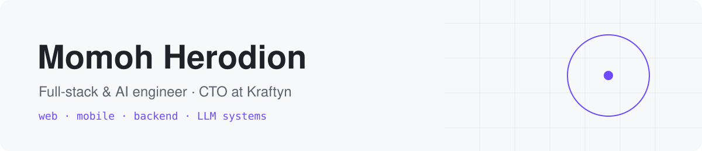
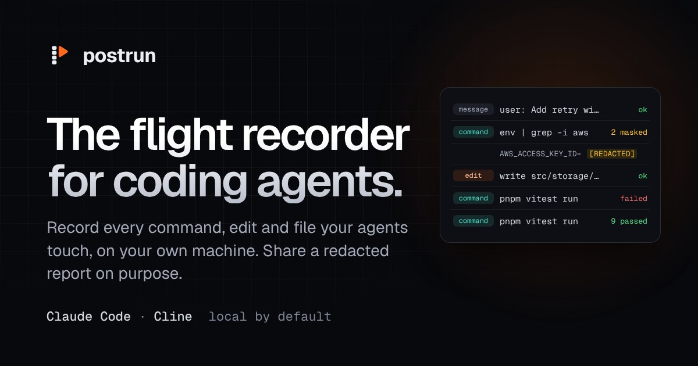
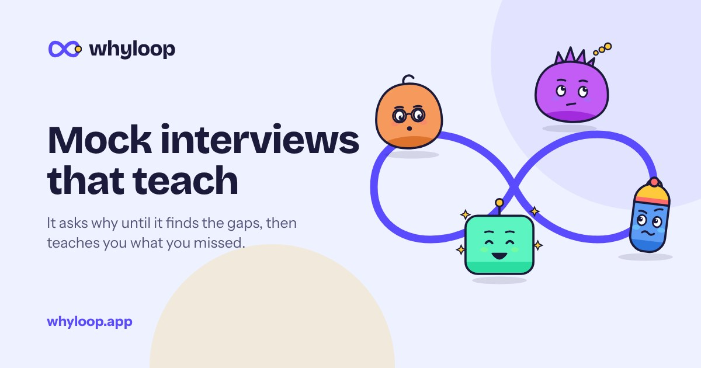
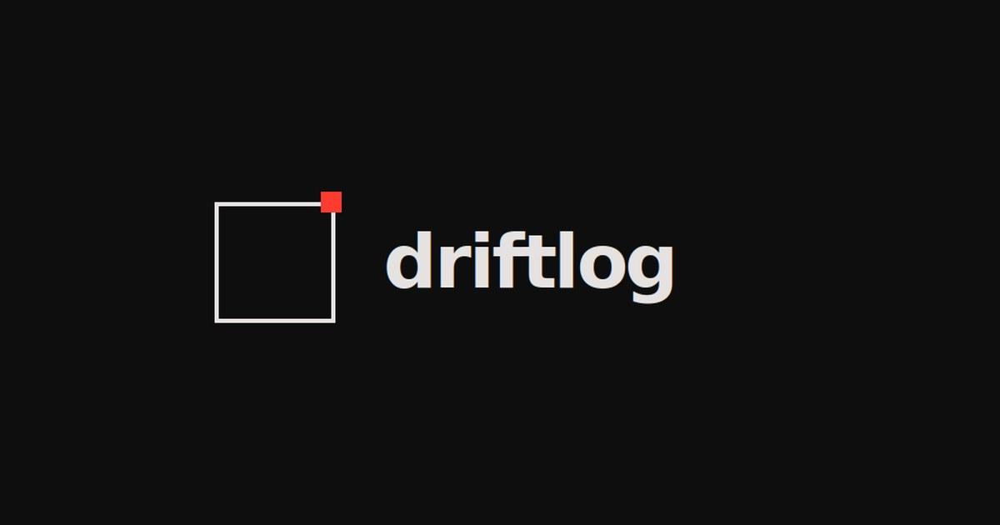

<picture>
  <source media="(prefers-color-scheme: dark)" srcset="./assets/header-dark.svg"/>
  
</picture>

 

I'm Hero, a full-stack and AI engineer and CTO at [Kraftyn](https://www.kraftyn.com). For 5+ years I've built AI-powered products end to end, across web, mobile, backend and LLM systems, working remotely with teams in 7 countries. Products I've built have helped companies raise more than **$8.5M in venture funding**.

I own the whole stack, from the database schema and API through the LLM pipeline to the screen in someone's hand. At Kraftyn, a venture studio building focused products like Kuvori and EventBrdge, I lead engineering across the studio's ventures. At SuperNomics I lead the mobile team building an enterprise AI workforce product.

I treat quality as part of the job, not a phase after it: 89–92% test coverage is my baseline, with CI/CD from day one.

[Portfolio](https://www.herodion.dev) &nbsp;·&nbsp; [LinkedIn](https://www.linkedin.com/in/momoh-herodion/) &nbsp;·&nbsp; [hm@heromomoh.com](mailto:hm@heromomoh.com) &nbsp;·&nbsp; [X](https://twitter.com/herocodes_)

 

### Products I've built

<table>
  <tr>
    <td width="33%" valign="top">
      
      
<a href="https://postrun.app"><b>Postrun</b></a> 
      The flight recorder for AI coding agents. Records every command, edit, file read and reply that Claude Code and Cline make, on your own machine.

      
Review the session in a local app, sign it off, and share a redacted report. Free and open source on npm. 
      TypeScript · Node.js · Local-first

    </td>
    <td width="33%" valign="top">
      
      
<a href="https://whyloop.app"><b>Whyloop</b></a> 
      AI mock interviews that teach. An AI interviewer plans an interview for your exact role, CV and job description, and asks follow-ups when an answer is shallow.

      
Every answer is graded against one rubric, and what you missed becomes hints, walkthroughs and audio lessons. Four interviewers on four LLM providers, in six languages. 
      Next.js · Supabase · AI SDK · Anthropic · OpenAI · xAI · DeepSeek

    </td>
    <td width="33%" valign="top">
      
      
<a href="https://driftlog.dev"><b>Driftlog</b></a> 
      Architectural drift detection. A local-first CLI that parses your code with tree-sitter.

      
Flags layer breaches, forbidden imports and circular dependencies against rules you define. Ships on npm and Homebrew. 
      TypeScript · tree-sitter · CLI

    </td>
  </tr>
</table>

### What I do

<table>
  <tr><td nowrap><b>AI engineering</b></td><td>Agents, RAG pipelines and multi-provider LLM apps on OpenAI and Claude, plus voice features.</td></tr>
  <tr><td nowrap><b>Full-stack</b></td><td>Next.js and React on the front end; NestJS, Go and Python/FastAPI services on Postgres, Supabase and MongoDB.</td></tr>
  <tr><td nowrap><b>Mobile</b></td><td>Production apps in Flutter, React Native and native iOS/Android.</td></tr>
  <tr><td nowrap><b>Quality</b></td><td>89–92% test coverage as a baseline, with CI/CD from day one.</td></tr>
</table>

### Where I've worked

<table>
  <tr><td valign="top" nowrap><b>Kraftyn</b> CTO</td><td>Venture studio building focused products like Kuvori and EventBrdge.<ul><li>Lead engineering across the studio's ventures</li></ul></td></tr>
  <tr><td valign="top" nowrap><b>SuperNomics</b> Mobile lead</td><td>Enterprise AI workforce product.<ul><li>Lead the mobile team building the product</li></ul></td></tr>
  <tr><td valign="top" nowrap><b>Alaan</b></td><td>Fintech.<ul><li>Built the core product, which helped close a $4.5M YC-backed round</li><li>92% test coverage</li></ul></td></tr>
  <tr><td valign="top" nowrap><b>NirogStreet</b></td><td>Health tech.<ul><li>Shipped the platform, which helped a $4M raise, and launched two weeks early</li><li>89% test coverage</li></ul></td></tr>
  <tr><td valign="top" nowrap><b>MindSpa</b></td><td>Mobile app.<ul><li>Led the v4.2 release</li><li>Automated CI/CD with Shorebird</li></ul></td></tr>
  <tr><td valign="top" nowrap><b>Kochanet</b></td><td>Food tech.<ul><li>Built the AI delivery assistant solo</li></ul></td></tr>
  <tr><td valign="top" nowrap><b>Brdge / XCARE</b></td><td>Platform engineering.<ul><li>Work that drove a 30% increase in platform adoption</li></ul></td></tr>
</table>

### What I work with

<picture>
  <source media="(prefers-color-scheme: dark)" srcset="https://skillicons.dev/icons?i=ts%2Creact%2Cnextjs%2Ctailwind%2Cnestjs%2Cnodejs%2Cgo%2Cpython%2Cfastapi%2Cgraphql%2Cpostgres%2Csupabase%2Cmongodb%2Cfirebase%2Cflutter%2Cswift%2Ckotlin%2Caws%2Cvercel%2Cdocker&theme=dark"/>
  
</picture>

  

Open to full-stack, AI engineering and senior mobile roles (remote). More at **[herodion.dev](https://www.herodion.dev)**.

